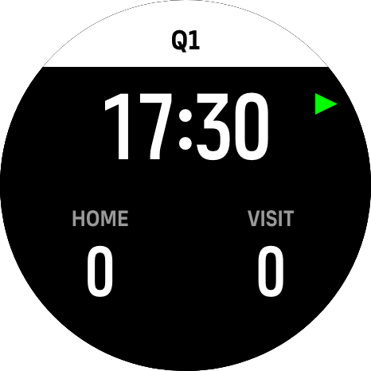
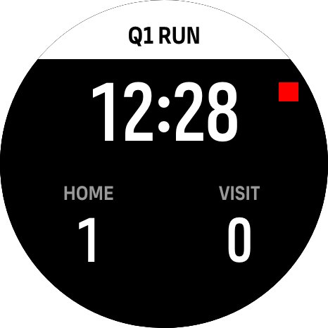
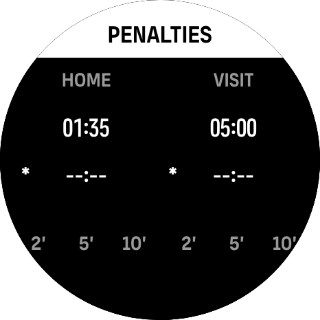
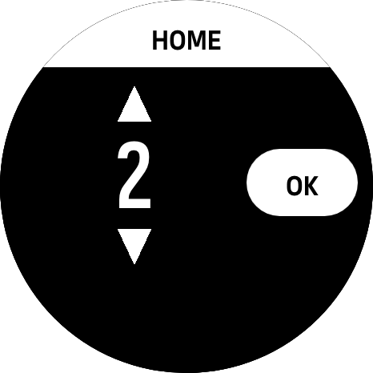

# suunto_field-hockey

SuuntoPlus app for field hockey referees. The app lives in [`field-hockey/`](field-hockey/) and is built and tested with the SuuntoPlus Editor extension for VS Code.

## Version 0.1

- 4 quarters of 17:30, counting down
- Break timer between quarters that counts up; the first press of the top button prepares the next quarter, the second starts it
- Short vibration every second for the last 10 seconds of a quarter, a single alarm at 0:00
- Score for home and visitors
- Time penalties of 2, 5 or 10 minutes, two slots per team, counting down with the game clock

## Screens

### 1. Time and score, clock stopped

Shows the quarter (Q1 to Q4), the game clock and both scores. The green triangle next to the top button means the clock is stopped: press the top button to start it. The clock counts down from 17:30. Tap a score to edit it.

### 2. Time and score, clock running

The title shows RUN and the red square means the clock is running: press the top button to stop it (STOP is shown in the title). The last 10 seconds of a quarter give a short vibration every second, and an alarm sounds at 0:00. After that the screen shows BREAK and a timer counting up. The next press of the top button prepares the next quarter and the press after that starts it.

### 3. Penalties

Switch to this screen with a short press of the bottom button. Every team has two independent slots. In the picture the home team has a penalty of 1:35 left, and the visitors have 5:00. The `*` marks the selected slot, the one that gets the next penalty. Tap a slot to select it, tap the selected slot again to cancel its penalty. Tap 2', 5' or 10' under a team to put that penalty in the selected slot. Penalties count down together with the game clock.

### 4. Score edit

Opens when you tap a score on the time/score screen. The title shows which team you are editing. Tap the upper arrow to add a point, the lower arrow to remove one, and OK to save the score and go back. The bottom button cancels the edit.

## Before you start

**Touch must be enabled on the watch.** Scores and penalties can only be set by tapping the screen. Suunto watches can disable touch during an exercise, and then the taps do nothing. In the watch settings, set the touch screen to always on, or on during exercise, before you start the workout.

## Controls

| Control | Action |
|---|---|
| Top button | Start / pause the clock. After a quarter ends: first press prepares the next quarter (full time, stopped), second press starts it |
| Bottom button, short press | Switch between time/score and penalties; cancels a score edit |
| Middle button | Not used by the app, so the watch menu stays available to leave the app |
| Bottom button, hold 5 s | Reset the clock of the current quarter to 17:30 (score and penalties are kept) |
| Tap a score | Open the score edit screen |
| Edit screen arrows / OK | Change the score / save it and go back |
| Penalties: tap a slot | Select the slot; tap the selected slot again to cancel its penalty |
| Penalties: 2' / 5' / 10' | Put that penalty in the selected slot |

Start the workout on the watch before the match. Pause the game clock with the top button, not by pausing the exercise.

## Files

- `field-hockey/main.js`: game clock, score, penalties and alerts
- `field-hockey/t.html`: the three screens
- `field-hockey/manifest.json`: app definition, outputs and images
